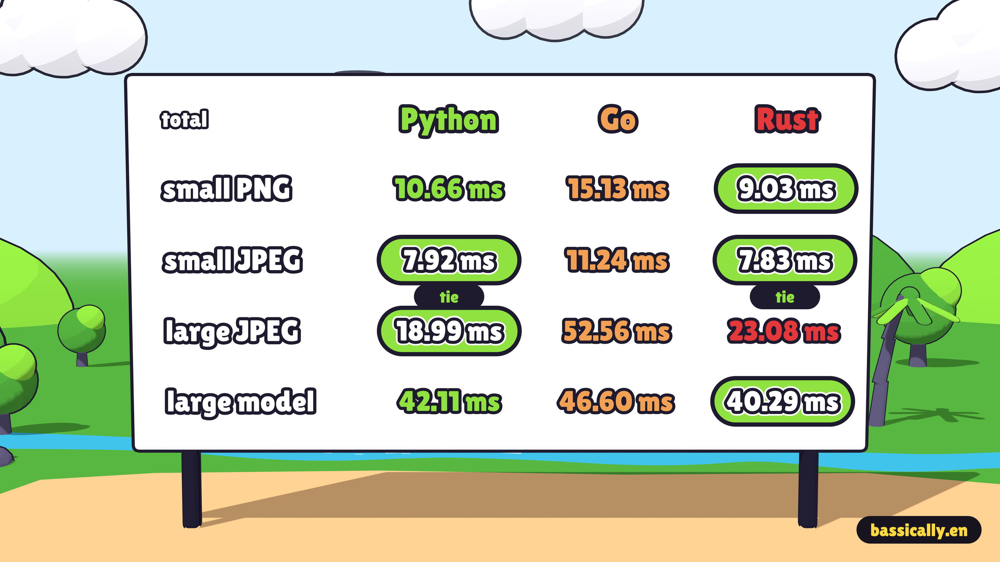
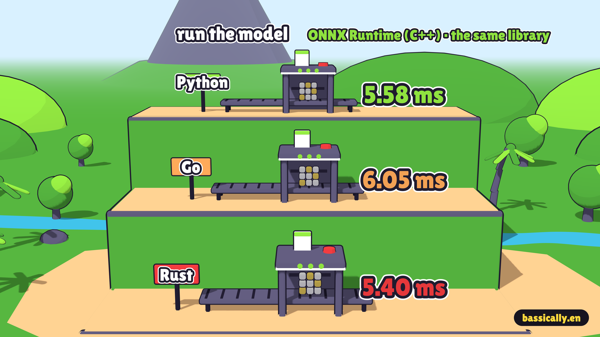
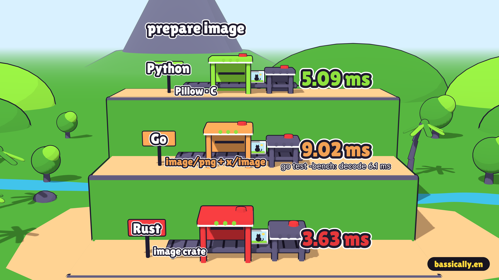
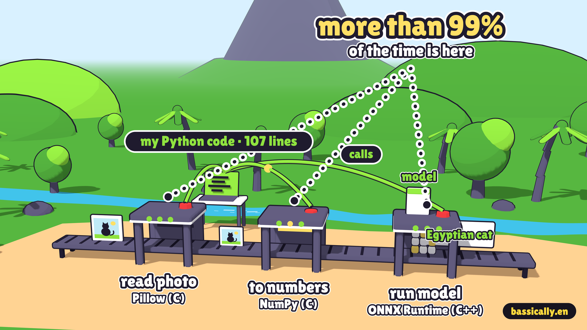

# 01 · Why is almost every AI service written in Python?

One inference request (decode, resize, normalize, run the model) written three times, in Python, Go and Rust, with the same model file, the same photo and the same ONNX Runtime 1.32.0 on CPU.

**Result: the model step costs almost the same in all three. The gap between the languages comes from their image libraries, and Go is slowest in every case.**



Full write-up: [haryarrahman.tech/blog/why-ai-services-use-python](https://haryarrahman.tech/blog/why-ai-services-use-python) · [Bahasa Indonesia](https://haryarrahman.tech/blog/kenapa-ai-service-pakai-python)

## Numbers

Median of ten runs, in milliseconds per request. Each run: 10 warm-up requests, then 200 measured. Fastest in bold.

**Total**

| Case | Python | Go | Rust |
|---|---:|---:|---:|
| small PNG (451x300, MobileNetV2) | 10.663 | 15.130 | **9.029** |
| small JPEG (same picture) | 7.917 | 11.238 | **7.825** |
| large JPEG (1920x1277) | **18.986** | 52.561 | 23.077 |
| large model (small PNG, ResNet50) | 42.111 | 46.603 | **40.286** |

**Model step only** (`infer`, ONNX Runtime)

| Case | Python | Go | Rust |
|---|---:|---:|---:|
| small PNG | 5.575 | 6.047 | 5.399 |
| small JPEG | 5.468 | 6.332 | 5.184 |
| large JPEG | 5.005 | 4.896 | 4.877 |
| large model | 36.853 | 37.531 | 36.620 |



**Image preparation only** (decode + resize + normalize)

| Case | Python | Go | Rust |
|---|---:|---:|---:|
| small PNG | 5.087 | 9.024 | **3.633** |
| small JPEG | **2.442** | 4.912 | 2.622 |
| large JPEG | **13.907** | 47.619 | 18.148 |
| large model | 5.183 | 9.061 | **3.676** |



## How to read them

- **Small JPEG is a tie between Python and Rust.** The 0.09 ms in the total is the median; run by run, Rust is behind in seven of the ten.
- **Python wins the large JPEG** because Pillow decodes with libjpeg-turbo, a C library tuned for this processor.
- **Go is slowest everywhere** because `image/png`, `image/jpeg` and `x/image/draw` are plain Go. Go was slower than Python in every case of every run.
- **Go's model step is not stable** in the two small cases: about 5.7 ms in some runs, about 6.3 ms in others, with the same ONNX Runtime binary as Rust. The cause is not established; one diagnostic run with the garbage collector off brought it level with Rust ([FAIRNESS.md](FAIRNESS.md)).
- **Pure Python is slow, which is why it does none of this work:** a 200x200 matrix multiplication takes 340.530 ms in a Python loop and 0.058 ms in NumPy (`python/matmul.py`).

## What is compared

Only ONNX Runtime is the same code in all three. Each language brings its own image library.

| Step | Python | Go | Rust |
|---|---|---|---|
| decode | Pillow (C) | `image/png`, `image/jpeg` | `image` crate |
| resize | Pillow (C) | `golang.org/x/image/draw` | `image` crate |
| normalize | NumPy (C) | a hand-written loop | a hand-written loop |
| model | ONNX Runtime (C++) | ONNX Runtime (C++) | ONNX Runtime (C++) |



The three `main` files have the same twelve functions with the same names in the same order, so they read side by side: [`python/main.py`](python/main.py) · [`go/main.go`](go/main.go) · [`rust/src/main.rs`](rust/src/main.rs).

## Method

- Each program times itself: 10 warm-up requests, 200 measured, median and p95 per step.
- Ten full runs; the tables use the median of the ten. Raw output: [`results/run1.txt`](results/) to `run10.txt`.
- Between runs the image numbers move by less than 2%, the model step by up to about 10%.
- CPU only in all three. On macOS the Rust binding (`ort`) picks CoreML by default, so it is forced to CPU.
- All three answer "Egyptian cat" in all four cases. Their inputs to the model match to within 1 level out of 255 for the PNG and 8 for the JPEGs, where the decoders differ. What was checked, and where the programs still differ: [FAIRNESS.md](FAIRNESS.md).

## Run it

Needs [`uv`](https://docs.astral.sh/uv/), Go (tested with 1.27.4) and Rust (`rust/rust-toolchain.toml` pins 1.100.0). From the repo root:

```sh
uv run shared/export_model.py      # the two ONNX models, the labels and the three test images
sh shared/get_onnxruntime.sh       # the ONNX Runtime 1.32.0 library for Go and Rust
sh 01-why-python/run_all.sh        # matmul.py, then the three programs, four cases each
```

Each program prints its top-3 guesses, the mean and std of its input tensor, the time per step, and a summary table per case. Close other heavy work first: a busy machine spoils the numbers.

Python alone: `cd 01-why-python/python && uv run matmul.py && uv run main.py`. Cross-check of Go's image numbers, from `go/`: `go test -bench . -benchmem -run '^$' -count 3`.

## Limits

- One request at a time. Many requests at once is [part 2](../02-thousand-requests/).
- One photo of a cat in all four cases; the large JPEG is that photo enlarged, not a native large photo.
- One machine.

## Setup

- MacBook Pro, Apple M1 Pro, 32 GB RAM, macOS 26.6.2
- ONNX Runtime 1.32.0, CPU, default threads
- Python 3.14.6, numpy 2.5.5, pillow 13.0.0
- Go 1.27.4, `github.com/microsoft/onnxruntime/go` at the v1.32.0 commit, `golang.org/x/image` 0.48.0
- Rust 1.100.0, `ort` 2.0.0-rc.15, `image` 0.25.10

## In this folder

- `python/`, `go/`, `rust/`: the same program in three languages.
- `results/`: raw output of the ten runs behind the tables.
- `proof/`: terminal screenshots of one more run.
- `FAIRNESS.md`: is the comparison fair, one line per finding. `FAIRNESS-full.md`: the audit in full.
- `run_all.sh`: runs everything.

The article and its illustrations are in [`content/01-why-python/`](../content/01-why-python/).
