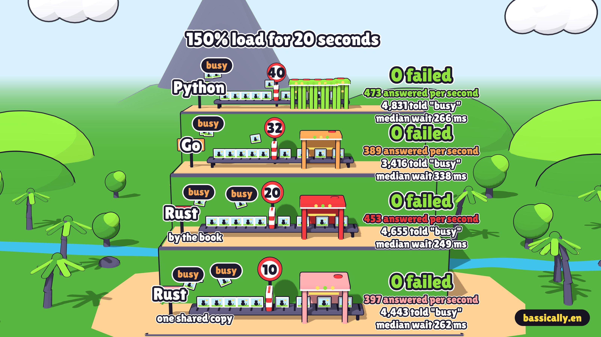
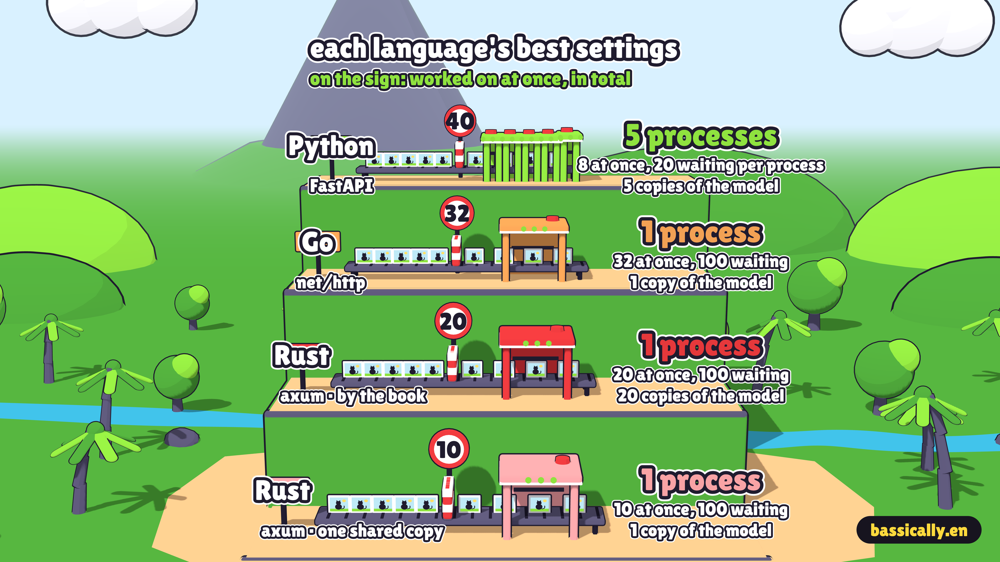

# 02 · A thousand requests at once: which breaks first, Python, Go or Rust?

The classifier from part 1 as an HTTP service in Python (FastAPI), Go (`net/http`) and Rust (axum), each tuned to its own best settings, then loaded with a thousand requests at once, with more traffic than the machine can serve, and with a thousand clients that retry non-stop.

**Result: none of them lost a request. What differs is the memory each one needs to get there, and for Rust that depends on one rule of its ONNX Runtime library.**


Full write-up: [haryarrahman.tech/blog/a-thousand-requests-at-once](https://haryarrahman.tech/blog/a-thousand-requests-at-once) · [Bahasa Indonesia](https://haryarrahman.tech/blog/seribu-request-sekaligus)

## Numbers

Median of five runs (`results/final/`). A request **fails** if the server does not accept the connection, or does not answer, within 10 seconds. "Busy" is an immediate HTTP 503 and is not a failure.

**Failed requests**

| Test | Python | Go | Rust, by the book | Rust, one shared copy |
|---|---:|---:|---:|---:|
| 150% of the ceiling, 20 s | 0 | 0 | 0 | 0 |
| 1,000 requests at the same moment | 0 | 0 | 0 | 0 |
| 1,000 clients retrying at once, 20 s | 0 | 0 | 0 | 0 |

**What it costs**

| | Python | Go | Rust, by the book | Rust, one shared copy |
|---|---:|---:|---:|---:|
| processes | 5 | 1 | 1 | 1 |
| copies of the model in memory | 5 | 1 | 20 | 1 |
| memory when idle | 852 MB | 99 MB | 367 MB | **84 MB** |
| peak memory under load | 933 MB | 479 MB | 675 MB | **316 MB** |

**Under load**

| | Python | Go | Rust, by the book | Rust, one shared copy |
|---|---:|---:|---:|---:|
| one request alone | 14.6 ms | 16.8 ms | 14.3 ms | 14.3 ms |
| 150% load: answered per second | 473 | 389 | 453 | 397 |
| 150% load: told "busy" in 20 s | 4,831 | 3,416 | 4,655 | 4,443 |
| 150% load: median wait | 266 ms | 338 ms | 249 ms | 262 ms |
| 1,000 at once: answered / told "busy" | 255 / 745 | 592 / 408 | 228 / 772 | 174 / 826 |
| 1,000 at once: all dealt with in | 0.6 s | 2.2 s | 0.6 s | 0.5 s |
| retry storm: turned away per second | 21,900 | 17,500 | 41,400 | 52,500 |
| retry storm: answered per second | 221 | 238 | 271 | 186 |



## How to read them

- **Do not rank "answered per second".** Between the five runs each server moved by 100 requests per second or more (Python 320 to 491), and the ranges overlap. Failures and idle memory did not move.[^noise]
- **Python needs five processes.** With one it failed the retry test, up to 414 connections in 10 seconds: accepting and refusing connections runs on one thread (the GIL). Each process loads its own model, hence 852 MB.[^python]
- **Rust's memory is the model, not Rust.** Its ONNX Runtime library, `ort`, gives one loaded model to one request at a time, so 20 requests at once need 20 copies, about 15 MB each. With one copy the same server idles at 84 MB.[^ort]
- **"One shared copy" breaks that rule with one `unsafe` line** and does what Python and Go do. It passed every test here, on the CPU, for minutes at a time. That is not proof that it is safe.[^unsafe]
- **Go needs one process and no trick**: 99 MB, and a limit written with a channel.

## The rules every server follows

1. Work on at most `LIMIT` requests at once.
2. Let at most `QUEUE` wait, first come, first served (100 in total for every language).
3. Answer `503 busy` to everyone beyond that, immediately.

Each language's own numbers were found by a search over 33 combinations with one rule: no failed request in any test, then the most requests answered per second at 150% load.[^search]

| | Processes | At once | Waiting | Setting in `results/final/` |
|---|---:|---:|---:|---|
| Python | 5 | 8 each | 20 each | `python-w5-l40` |
| Go | 1 | 32 | 100 | `go-l32-t1` |
| Rust, by the book | 1 | 20 (20 sessions) | 100 | `rust-l20-t1` |
| Rust, one shared copy | 1 | 10 (1 session) | 100 | `rust-shared-l10` |



## Run it

Needs [`uv`](https://docs.astral.sh/uv/), Go (tested with 1.27.4), Rust (`rust/rust-toolchain.toml` pins 1.100.0), [`oha`](https://github.com/hatoo/oha) 1.17.0, and a laptop on AC power (the harness refuses to run on battery). Once, from the repo root:

```sh
uv run shared/export_model.py && sh shared/get_onnxruntime.sh && brew install oha
```

Then, from this folder:

```sh
(cd go && go build -o thousandrequests) && (cd rust && cargo build --release)
# the search for each language's settings (about 25 minutes per pass)
uv run bench.py results/sweep/run1 --sweep --seconds 10
uv run bench.py --pick results/sweep
# five full passes of the chosen settings, then the medians
uv run bench.py results/final/run1 --sweep --all-cases --only python-w5-l40,go-l32-t1,rust-l20-t1,rust-shared-l10
uv run bench.py --summary results/final
```

One server by hand:

```sh
cd go && ORT_THREADS=1 LIMIT=32 QUEUE=100 ./thousandrequests
curl -s -X POST --data-binary @../../shared/cat.jpg localhost:8000/classify
# {"label":"Egyptian cat","prob":0.2229907512664795}
```

The three servers (`python/main.py`, `go/main.go`, `rust/src/main.rs`) have the same functions, with the same names and order. Settings are environment variables: `PORT`, `ORT_THREADS`, `LIMIT`, `QUEUE`, plus `WORKERS` (Python) and `SESSIONS`, `SHARE_SESSION` (Rust).

## Limits

- The load tool runs on the same laptop as the server.
- One small photo, one small model, one machine, the CPU only.
- The search ran each combination twice for 10 seconds per test; close candidates cannot be told apart.
- The servers were tuned, not the image code: decode and resize are part 1's.
- The queue of 100 is a choice, not a measurement.

The defaults (no limit, no queue, no tuning) are part 3's subject; their runs are already in `results/run1..5`.

## Files

- `results/final/`: the five runs quoted above, `summary.md` with medians and ranges.
- `results/sweep/`, `results/sweep2/`: the two searches for settings.
- `results/best/`, `results/limit*/`, `results/run*`: earlier sets (first tuned pass, identical limits, defaults).
- `results/discarded/`: runs thrown away, with the reason in the name (lid closed, on battery).
- `proof/`: terminal screenshots.
- [FAIRNESS.md](FAIRNESS.md): what is equal and what is not, one line per finding. [FAIRNESS-full.md](FAIRNESS-full.md): the long version.

Setup: MacBook Pro, Apple M1 Pro (10 cores), 32 GB, macOS 26.6.2, AC power; ONNX Runtime 1.32.0 on CPU, one thread per request; Python 3.14.6, fastapi 0.163.2, uvicorn 0.54.0; Go 1.27.4; Rust 1.100.0, axum 0.8.9, tokio 1.54.1, `ort` 2.0.0-rc.15.

[^noise]: Answered per second at 150% load across the five passes: Python 320 to 491, Go 293 to 465, Rust by the book 360 to 545, Rust shared 353 to 523. Another program was working on the laptop during part of the runs. Idle memory per pass stayed within a few MB.
[^python]: First search (`results/sweep/`): one process, 20 at once: 402 and 414 failed connections in the 10-second retry case; two processes: up to 128; five and ten processes: none. Ten processes used about 1.6 GB.
[^ort]: Idle memory of the Rust server by number of sessions: 84 MB with 1, 220 MB with 10, 367 MB with 20; the model file is 13.6 MB. `ort` 2.0.0-rc.15, `Session::run` takes `&mut self`; the maintainer's reasons: [pykeio/ort#402](https://github.com/pykeio/ort/issues/402#issuecomment-2949993914).
[^unsafe]: `SHARE_SESSION=1` in `rust/src/main.rs` (`SharedSession`). Check made: 200 requests in parallel returned 200 identical answers. Not tested: GPU providers, long runs, other models.
[^search]: 23 combinations in `results/sweep/` and 13 in `results/sweep2/` (three repeated), two passes each. `go-l48-t1` was excluded for 14 failed requests. Rust by the book was searched up to 20 at once, the others up to 48.
