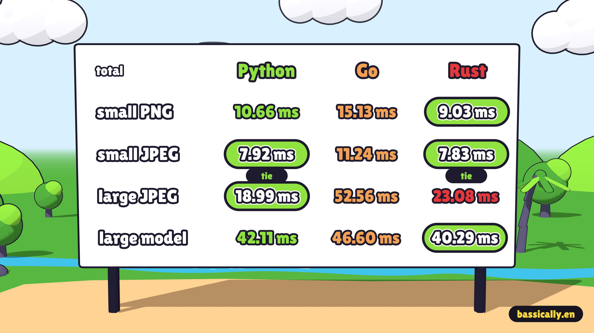

# AI Service Series

One AI service, written in Python, Go and Rust, and measured. Every part has code you can run, the raw results, and an article.

The shared example: image classification. A photo goes in, MobileNetV2 says what is in it. The model is exported to ONNX once (`shared/export_model.py`) and the same file runs from all three languages through ONNX Runtime.


## Parts

| | Question | Short answer | Read | Code |
|---|---|---|---|---|
| 01 | Why is almost every AI service written in Python? | The model step costs almost the same in all three languages. The gap comes from their image libraries, and Go is slowest in every case. | [Article](https://haryarrahman.tech/blog/why-ai-services-use-python) · [Indonesian](https://haryarrahman.tech/blog/kenapa-ai-service-pakai-python) | [`01-why-python/`](01-why-python/) |
| 02 | A thousand requests at once: which breaks first, Python, Go or Rust? | In progress | | |
| 03 | To be decided | | | |
| 04 | To be decided | | | |

## Part 1 in one picture

Total time of one request, median of ten runs, in milliseconds:

| Case | Python | Go | Rust |
|---|---:|---:|---:|
| small PNG | 10.663 | 15.130 | **9.029** |
| small JPEG | 7.917 | 11.238 | **7.825** |
| large JPEG | **18.986** | 52.561 | 23.077 |
| large model | 42.111 | 46.603 | **40.286** |



The breakdown per step, the method and the limits are in [`01-why-python/`](01-why-python/).

## Run it

Needs [`uv`](https://docs.astral.sh/uv/), Go and Rust.

```sh
uv run shared/export_model.py      # the ONNX models, the labels and the test images
sh shared/get_onnxruntime.sh       # the ONNX Runtime library for Go and Rust
sh 01-why-python/run_all.sh        # part 1: the same request in all three
```

## Rules of the series

- Every number comes from the code in this repo, run on the machine named in its article. The raw output is in each part's `results/`.
- The three versions do the same work; each part has a `FAIRNESS.md` that says what was checked and where they still differ.
- Claims about libraries are checked against their documentation or source, and linked in the article's Sources.

Articles: [haryarrahman.tech/blog](https://haryarrahman.tech/blog) · Short videos: [@bassically.en](https://www.instagram.com/bassically.en/) (English), [@dasarnya.id](https://www.instagram.com/dasarnya.id/) (Indonesian)
